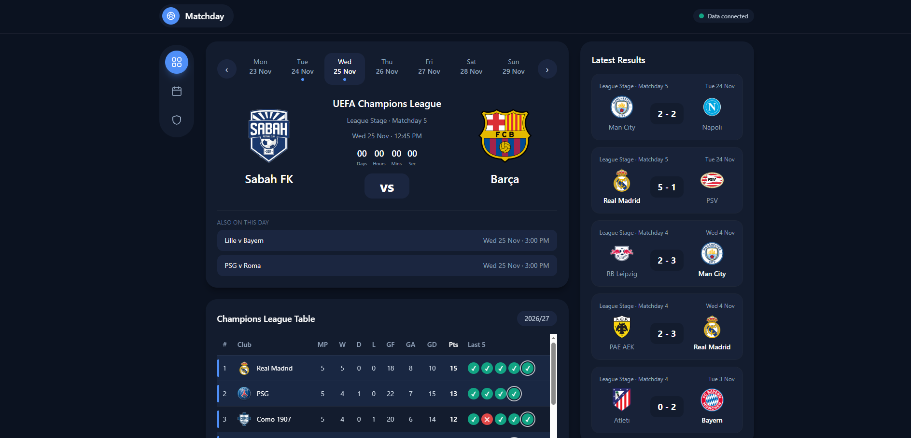
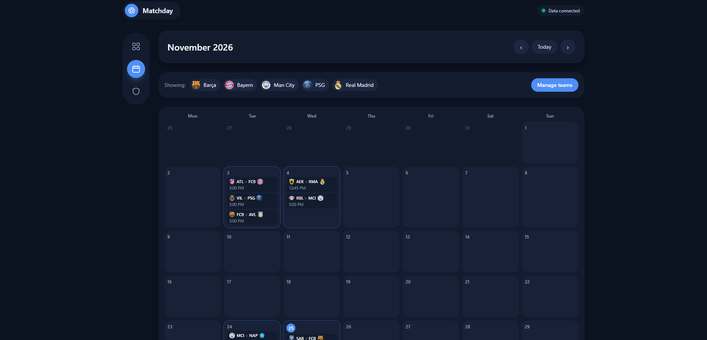
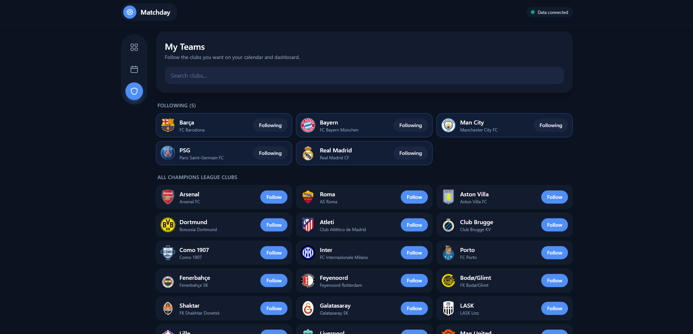
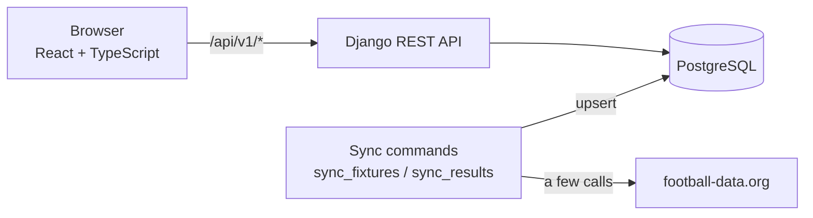

# ⚽ Matchday

A personal football dashboard that tracks the **UEFA Champions League** for the clubs I follow: when they play, who they play, how they're doing, and the full league-phase table, on desktop and mobile.

Built with **React + TypeScript**, **Django REST Framework** and **PostgreSQL**, with data from [football-data.org](https://www.football-data.org/).

## Screenshots

**Dashboard**: week strip, featured match with countdown, Champions League table with last-5 form, and latest results.



**Calendar**: a month view with only the followed clubs' fixtures and kickoff times.



**My Teams**: search and follow clubs; the calendar and dashboard update straight away.



---

## Features

- **Dashboard**
  - **Week strip** (Mon–Sun) with a dot on every day one of my teams plays.
  - **Featured match** with both crests, the stage, the kickoff in local time, and a live countdown to kickoff (or the final score once it's played).
  - **Champions League table** in the same format as Google's: MP, W, D, L, GF, GA, GD, Pts and the **last 5 results**, with qualification zones marked and my clubs highlighted.
  - **Latest Results**: my clubs' most recent final scores.
- **Calendar**: a month view showing only my teams' fixtures and their opponents, with kickoff times. On phones it becomes a list of match days.
- **Club page**: search any club, or tap one of your teams, to see that club's season stats (played, W/D/L, goals, clean sheets, win rate, last 5), its upcoming matches, and every result, newest first. Switch seasons with a dropdown. **Click any crest or club name** anywhere in the app (table, calendar, results, team chips) to jump straight to that club.
- **My Teams**: search the current season's Champions League clubs and follow or unfollow them. The calendar and dashboard update straight away.
- **Multiple seasons**: the calendar goes back to January 2026 (the 2025/26 season) and forward through 2027. New seasons are picked up automatically.
- **Responsive**: side navigation and multi-column layouts on desktop; a single column with a bottom tab bar on mobile.

## Tech stack

| Layer | Technology |
| --- | --- |
| Frontend | React 19, TypeScript, Vite, Tailwind CSS v4, TanStack Query, React Router, date-fns |
| Backend | Python, Django 6, Django REST Framework |
| Database | PostgreSQL 16 (Docker) |
| Data source | [football-data.org](https://www.football-data.org/) v4 API (free tier) |

## Architecture



**The browser never calls the football API.** Only the backend's sync commands talk to football-data.org; they save everything into PostgreSQL, and the app reads only from its own database. That means:

- The API token never reaches the browser.
- Visitors can't use up the rate limit (10 requests/minute on the free tier).
- The app keeps working even if the external API is down.

### Keeping API calls to a minimum

| Command | What it does | API calls |
| --- | --- | --- |
| `sync_fixtures` | Pulls the whole season's schedule and the current table. Run once a week, or after a draw. | 2 |
| `sync_fixtures --all` | Same as above for every season from `FIRST_SEASON` to now (first-time setup). | 2 per season |
| `sync_results` | Checks the **database first**: only if a match kicked off 2+ hours ago and isn't marked finished does it fetch that day's results, then refresh the table. | Usually **0**; otherwise 1 per match day + 1 for the table |

Run every 15 minutes, `sync_results` makes zero API calls on almost every run and picks up each final score shortly after the match ends.

## Design decisions

- **A provider adapter.** All football-data.org code lives in `matches/providers/football_data.py`, which turns API JSON into simple dataclasses. Switching to another provider (e.g. API-Football) means writing one new adapter; nothing else changes.
- **Each part has one job:**
  - `providers/` fetches from the API.
  - `services.py` writes to the database.
  - `selectors.py` reads from it.
  - Views stay a few lines long.
- **Syncs are idempotent.** Every external row is stored with its unique `provider_id` and saved with `update_or_create` inside a transaction. Re-running a sync never creates duplicates, and a failed sync never leaves half its changes behind.
- **Times are stored in UTC and shown in local time.** Kickoffs are saved as UTC timestamps; the browser converts them to the viewer's time zone.
- **Derived data is computed, not stored.** Last-5 form and goal difference are calculated from stored matches, in one query for the whole table (no N+1 queries).
- **The client caches.** TanStack Query caches each week and month, so going back to a page you've already seen makes no request.

## Project structure

```
football/
├── backend/
│   ├── config/                 # Django settings and root URLs
│   └── matches/                # The app
│       ├── models.py           # Team, Match, Standing
│       ├── providers/          # football-data.org adapter (the only code that calls the API)
│       ├── services.py         # Writes: upsert teams, matches, standings
│       ├── selectors.py        # Reads: date-range queries, last-5 form
│       ├── serializers.py
│       ├── views.py
│       ├── urls.py
│       └── management/commands/
│           ├── sync_fixtures.py
│           └── sync_results.py
├── frontend/
│   └── src/
│       ├── api/                # Typed fetch functions + shared types
│       ├── hooks/              # TanStack Query hooks (useMatches, useStandings, useTeams…)
│       ├── components/         # UI: MatchdayCard, StandingsTable, calendar/, layout/…
│       ├── pages/              # Dashboard, Calendar, Teams
│       └── lib/                # Date and label helpers
├── docker-compose.yml          # PostgreSQL
└── .env.example                # Environment variables to copy into .env
```

## Getting started

### Prerequisites

- Python 3.12+
- Node.js (LTS)
- Docker Desktop
- A free API token from [football-data.org](https://www.football-data.org/client/register)

### 1. Clone and configure

```bash
git clone https://github.com/AbdullahAlNaim/football.git
cd football
cp .env.example .env        # Windows PowerShell: Copy-Item .env.example .env
```

Edit `.env` and set your own `DJANGO_SECRET_KEY`, `DB_PASSWORD` and `FOOTBALL_DATA_TOKEN`.

### 2. Start the database

```bash
docker compose up -d db
```

PostgreSQL is mapped to port **5433** on your machine, so it won't clash with a local Postgres.

### 3. Backend

```bash
cd backend
python -m venv venv
venv\Scripts\Activate.ps1          # macOS/Linux: source venv/bin/activate
pip install -r requirements.txt

python manage.py migrate
python manage.py createsuperuser   # for the Django admin
python manage.py sync_fixtures --all   # loads every season's matches and tables (FIRST_SEASON to now)
python manage.py runserver
```

The API runs at http://localhost:8000/api/v1/ and the admin at http://localhost:8000/admin/.

### 4. Frontend

In a second terminal:

```bash
cd frontend
npm install
npm run dev
```

Open http://localhost:5173. Vite forwards `/api` requests to Django, so there's no CORS setup in development.

### 5. Pick your teams

Go to **Teams** (the shield icon), follow your clubs, and their fixtures appear on the dashboard and calendar.

## Updating the data

Syncing isn't scheduled yet (see the [roadmap](#roadmap)), so the data only changes when you run a sync command. If a match that's already been played still shows **"vs"** and a countdown at `00`, or the table and last-5 form look behind Google's, the data just needs a sync.

### Which command to run

| When | Command | What it updates | API calls |
| --- | --- | --- | --- |
| **After a match day** (recommended) | `python manage.py sync_results` | Scores and status of every match that kicked off 2+ hours ago, **and the league table** | 0 if nothing's pending; otherwise 1 per match day + 1 |
| Once a week, or if kickoff times changed | `python manage.py sync_fixtures` | The whole current season: every match, rescheduled kickoffs, and the table | 2 |
| First-time setup, or to fill in past seasons | `python manage.py sync_fixtures --all` | Every season from `FIRST_SEASON` (default 2025) to the current one | 2 per season |
| Start of a new season | Nothing to change: the current season is worked out from today's date (from July it's the new season). Just run `sync_fixtures` | The new season's teams, schedule and table | 2 |
| After a knockout draw | `python manage.py sync_fixtures` | Adds knockout fixtures once both teams are known | 2 |

### Steps (Windows PowerShell)

```powershell
# 1. Make sure the database is running
docker compose up -d db

# 2. Activate the backend environment
cd backend
venv\Scripts\Activate.ps1

# 3. Sync
python manage.py sync_results
```

On macOS or Linux, activate with `source venv/bin/activate` instead.

Then **reload the page** in the browser. The frontend caches data for up to 5 minutes, and a reload fetches it fresh. You don't need to restart Django or Vite.

To check it worked: in the admin (http://localhost:8000/admin/), **Matches** should show `FINISHED` with scores for games that have been played.

### If something looks off

| What you see | Why | Fix |
| --- | --- | --- |
| A finished match still shows "vs" | Not synced since it ended, or football-data.org hasn't marked it finished yet (free-tier scores lag slightly) | Run `sync_results` again a little later |
| Last 5 has fewer dots than MP | Same cause: the table counts a match your stored results don't have yet | `sync_results` |
| `Skipped 2025: 403 …` during `--all` | Your football-data.org plan doesn't include that season | Raise `FIRST_SEASON` in `.env`, or use a plan that covers it |
| `RateLimited` error | More than 10 API calls in a minute | Wait 60 seconds and run it again |
| `Your API token is invalid` | Wrong or missing `FOOTBALL_DATA_TOKEN` in `.env` | Copy the token from your football-data.org account |
| A connection error mentioning port 5433 | The database container isn't running | `docker compose up -d db` |

### Optional: sync automatically every night on Windows

Until the worker container exists, Windows Task Scheduler can run the sync daily. Replace `C:\path\to\football` with where you cloned the repo; Docker Desktop has to be running for the database to be reachable.

```powershell
schtasks /Create /TN "Matchday sync" /SC DAILY /ST 23:30 /TR "C:\path\to\football\backend\venv\Scripts\python.exe C:\path\to\football\backend\manage.py sync_results"
```

Champions League matches finish by about 5:00 PM US Eastern, so a late-evening run catches every result that day. Remove it with `schtasks /Delete /TN "Matchday sync"`.

## API

All endpoints are under `/api/v1/`.

| Method | Endpoint | Description |
| --- | --- | --- |
| GET | `health/` | API and database status (`503` if the database is down) |
| GET | `matches/?from=YYYY-MM-DD&to=YYYY-MM-DD&followed=true` | Matches in a date range (up to 62 days), with nested teams |
| GET | `standings/?season=2026` | League-phase table with goal difference and last-5 form |
| GET | `teams/?followed=true&season=current` | All teams; optionally only followed ones and/or only this season's clubs |
| GET | `teams/{id}/results/?season=2026` | One club's season: stats, last 5, upcoming matches, and results newest first |
| GET | `seasons/` | The current season and every season stored |
| PATCH | `teams/{id}/` | Follow or unfollow a team: `{"is_followed": true}` |

## Management commands

```bash
python manage.py sync_fixtures              # latest: full schedule + table for the current season
python manage.py sync_fixtures --all        # every season from FIRST_SEASON to now
python manage.py sync_results               # final scores for matches that should be over, then the table

# Optional: load a past season instead (seasons are named by their start year)
python manage.py sync_fixtures --season 2025   # the 2025/26 season
```

## Roadmap

- [ ] **Where to watch:** a broadcaster badge on each match (in the US, Champions League matches stream on Paramount+)
- [x] **Club page:** season stats, upcoming matches and results for any club
- [ ] **More leagues:** La Liga, Premier League, Bundesliga, Ligue 1, with a league selector on the table
- [ ] **Run the sync automatically:** a worker container that runs `sync_results` every 15 minutes
- [ ] **Full Docker setup:** backend and frontend containers with Caddy for HTTPS
- [ ] **Deploy** to a small VPS, then move to a Raspberry Pi for self-hosting
- [ ] **Lock down writes:** make following teams require login before deploying publicly
- [ ] **Tests:** pytest for the sync mapping and form logic; Vitest for the date helpers

## Data

Football data provided by [football-data.org](https://www.football-data.org/). Free-tier scores can be slightly delayed.
